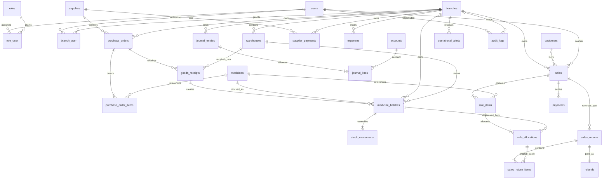

# Database relationships and invariants

The executable column specification is `database/migrations/2026_10_15_000001_create_pharmacy_tables.php`, in addition to Laravel's identity, session, cache and queue migrations. All domain IDs are unsigned bigint primary keys. Money uses DECIMAL(14,2); quantities are integer dispensing units. Domain foreign keys restrict deletion. Completed transactions have no delete endpoints. `created_at` and `updated_at` are UTC timestamps unless a table explicitly has only `created_at`.

| Table | Required business values and constraints |
| --- | --- |
| users | Laravel identity fields; password hash hidden; active defaults true; unique email. Sessions are revoked when administrator changes access or password is reset. |
| roles | Unique name; JSON permission names. Permission arrays are a deliberate small role system, rather than redundant permission/pivot tables. |
| role_user / branch_user | Composite primary key prevents duplicate assignments; restricted foreign keys. |
| branches | Unique immutable code, name, timezone, locked monotonically increasing invoice sequence. |
| warehouses | Branch required; name unique within branch. Every selected warehouse is checked against transaction branch. |
| medicines | Unique SKU; optional unique primary barcode; required name, price, category, dispensing unit, tax basis points and reorder threshold. Optional generic/manufacturer/strength/form/storage. Active and prescription classification flags. Shared master across branches. Archive instead of deleting. |
| suppliers / customers | Required name; optional phone/email/address; active status. Shared contact masters; branch-scoped transactions. No clinical information stored. |
| purchase_orders | Branch, supplier, creator and receiving state. Creating an order does not create stock or payment. |
| purchase_order_items | Unique medicine per order; ordered units, received units, decimal acquisition cost. Received cannot exceed ordered through the service. |
| goods_receipts | Order, warehouse, creator, unique UUID request key, decimal total. Separate receipt per partial delivery; currently also the supplier accrual source. |
| medicine_batches | Medicine, branch, warehouse, lot, receipt (nullable for future opening stock), cost, received/remaining/quarantine units. Optional date-only expiry. Null expiry means explicitly no expiry. Available and quarantined balances are separate. |
| stock_movements | Batch implies medicine/branch/warehouse; creator, signed available delta, signed quarantine delta, type and immutable source reference; optional reason. Model rejects edits/deletes. No historical-edit endpoints. |
| sales | Required branch, warehouse, cashier, unique invoice, unique UUID request key and request hash; optional customer; authoritative subtotal, discount, tax, total, cost, change. Completed only as an atomic checkout result. |
| sale_items | Sale and medicine, name snapshot, original quantity/price/discount/tax/total. No recalculation from current medicine prices for returns. |
| sale_allocations | Original item/batch, dispensed units, returned units, cost snapshot. Returned units never exceed allocation units through the service. |
| payments | Sale, method, amount actually retained (cash tender minus change). Raw card details are never collected. |
| sales_returns | Original sale, responsible user, unique UUID, reason and amount. |
| sales_return_items | Original allocation, linked return, quantity and refund amount; quarantines original batch units. |
| refunds | Unique return linkage, cash method, amount; one refund per return. |
| supplier_payments | Branch, supplier, user, unique UUID, method, amount; cannot exceed accrued supplier liability less prior payments. |
| expenses | Branch, user, category/description, unique UUID, method and amount. Represents an authorized immediately paid expense, not a draft approval workflow. |
| accounts | Unique fixed account code, name and accounting type. |
| journal_entries | Branch, user, unique immutable source, description, posting date. Generated with source transaction, never through arbitrary browser line amounts. |
| journal_lines | Entry and account; nonnegative debit/credit with only one side per nonzero line. Entry debit total must equal credit total. Model rejects edits/deletes. |
| audit_logs | Action, subject reference, timestamp; nullable user/branch for identity/system events; optional nonsensitive JSON metadata. |
| operational_alerts | Branch, unique condition key, message and resolved state. Repeated checks update rather than duplicate. |
| settings | Key primary key and value; reserved schema, not exposed as a completed settings feature. Current supported configuration is in `.env` and `config/pharmacy.php`. |

Batch lookup indexes cover branch/warehouse/medicine/expiry; transactional lists index branch/time; catalog search indexes name and generic; journals index branch/posting date. Search uses bounded results; lists use server pagination. Barcode alternates, fractional packs, advanced classifications and warehouse-specific user grants are future schema extensions.
